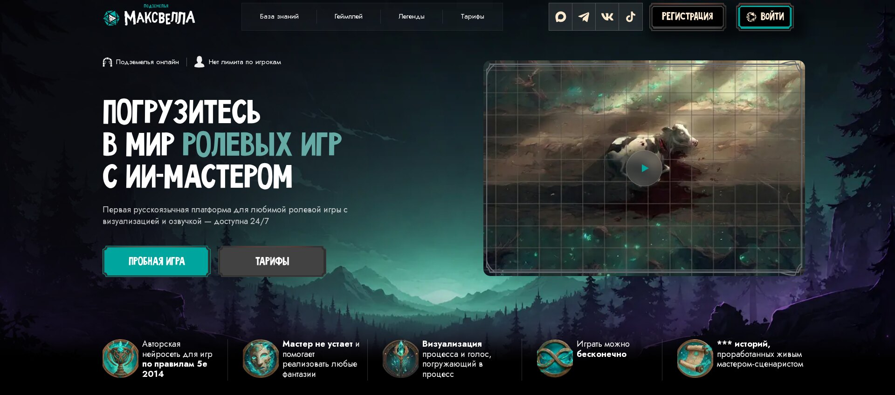
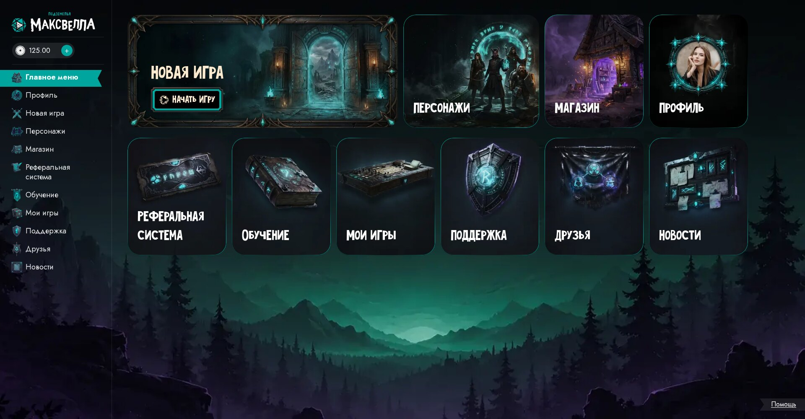
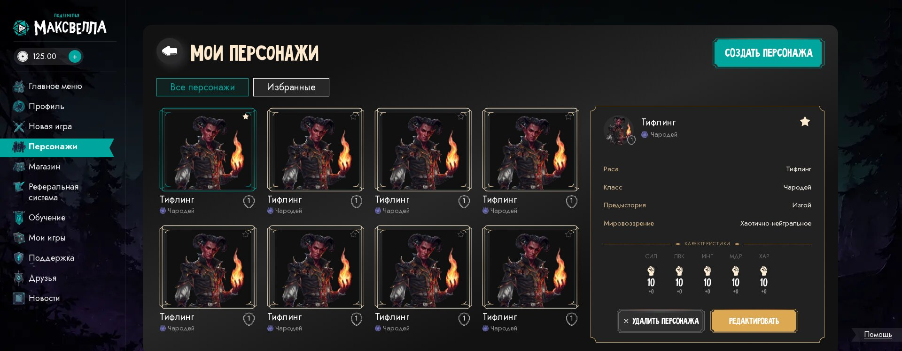
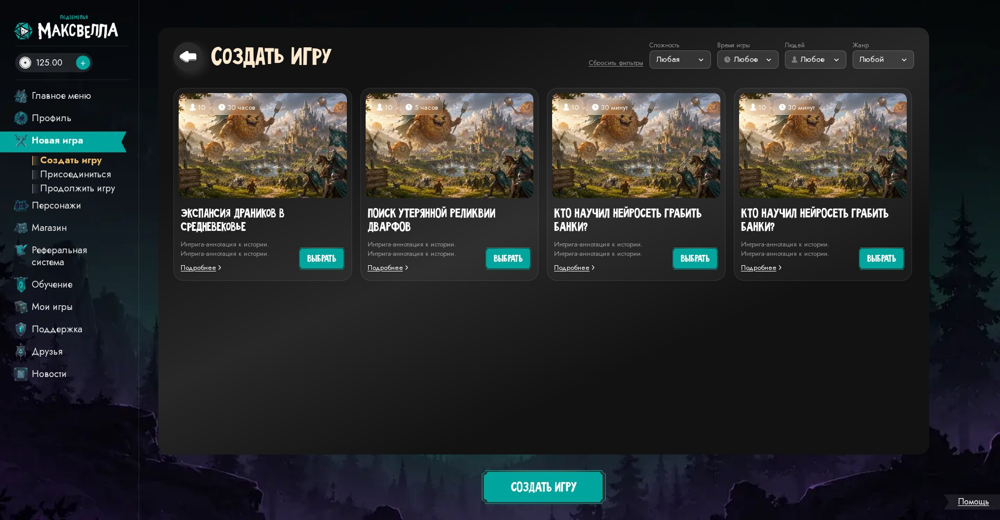

# Maxwell's Dungeons — frontend case study

> **EN**: Frontend of an online Dungeons & Dragons 5e platform where the Dungeon Master is an AI. I build and own the web client. The source code is private; this repository describes the work.
>
> **RU**: Фронтенд онлайн-платформы для игры в D&D 5e, где роль Мастера выполняет ИИ. Я разрабатываю и веду веб-клиент. Исходный код закрыт; этот репозиторий — описание проделанной работы.



## My role

Sole frontend developer since April 2026: 211 of 233 commits in the client repository. I work with a backend developer and a designer, and I am responsible for the client architecture, the implementation of every page from the Figma mockups, the integration with the backend API, and the build and deployment setup of the frontend.

## Stack

| Area | Tools |
|---|---|
| Framework | Next.js 16 (App Router), React 19 |
| Language | TypeScript 5, `strict` mode, zero `any` in the codebase |
| Styling | Tailwind CSS 4 |
| State | React Context (auth, modals, toasts) and data hooks |
| Delivery | Docker (multi-stage build), GitHub Actions, GitHub Container Registry |
| Quality tooling | ESLint, Playwright + reg-cli visual comparison against Figma |

The client has no runtime dependencies besides Next.js and React: carousels, modals, toasts, form validation and the data layer are written in-house.

## Scale

- ~38,000 lines of TypeScript in 308 files
- 168 component files, 30 hooks, 31 API services, 18 type modules
- 20+ routes in five route groups: landing, user dashboard, game, promo, internal UI playground
- Layouts from 1920 px desktop down to 320 px mobile

## What is built

**Landing page.** Twelve sections with content loaded from the API: game modes, pricing, platform features, FAQ, promo.

**User dashboard.** Profile, characters, shop, friends with chat, referral program, news, tutorial, support, saved games.



**Character builder.** A ten-step wizard that follows the D&D 5e rules: name, gender, race, subrace, class, subclass, background, alignment, ability scores, spells. Later steps depend on earlier choices (subraces for the chosen race, spells for the chosen class), the wizard reports which steps are still missing before submission, and any step or the whole character can be randomized or filled from a template.



**Game lobby.** Creating a game from a story catalogue with filters, joining a room by code and password, continuing a saved game.



**Authentication.** Email registration, login, password reset and Telegram login, all handled by the backend through a proxy layer.


## Architecture

The data layer has one shape across the whole application:

```
types/      contract with the backend (one module per domain)
   ↓
services/   fetch calls to the API, shared retry helper
   ↓
hooks/      loading / error / data state for components
   ↓
components/ sections → layouts → UI primitives
```

- **Backend integration.** The browser only talks to its own origin. Next.js rewrites forward auth, profile and character-builder requests to the backend, and server-side route handlers cover the calls that need server-only headers. The backend address is a build argument, so the same image definition serves staging and production.
- **Route groups.** Each area (`(index)`, `(lk)`, `(game)`, `(promo)`) has its own layout, so the landing header, the dashboard sidebar and the full-screen game shell do not leak into each other.
- **Mock layer.** Typed mocks mirror the backend contracts, so pages are built and reviewed before the matching endpoint exists and are switched to the real API without changing components.
- **UI playground.** A `(dev)` route group renders primitives, modals and hover states in isolation for checking against the mockup.

## Visual comparison pipeline

Checking a layout against a mockup by eye is slow and subjective, so I built a tool that does it in one command:

1. A script exports the reference frames from the Figma REST API.
2. Playwright opens the production build, takes each screenshot at the exact size of its reference frame, with animations disabled and fonts loaded.
3. reg-cli builds an HTML report with an expected / actual / diff slider for every page.

A single manifest lists the pages. Each entry can describe clicks, hovers and intercepted network responses, so the tool also captures states that depend on a server answer: an empty list, a wrong room password, a deleted character.

## Delivery

- Multi-stage Dockerfile: dependencies, build, runtime.
- A push to `main` builds the image and publishes it to GitHub Container Registry.
- A push to `staging` rebuilds and restarts the container on the staging server through a self-hosted runner.

## Contact

Alexander Terentyev — Telegram [@meaning_inside](https://t.me/meaning_inside), terentjev.selogaz@yandex.ru

A walkthrough of the code is available on a call.
